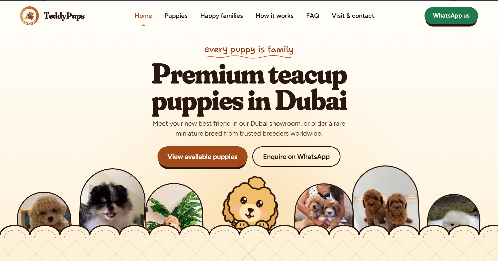
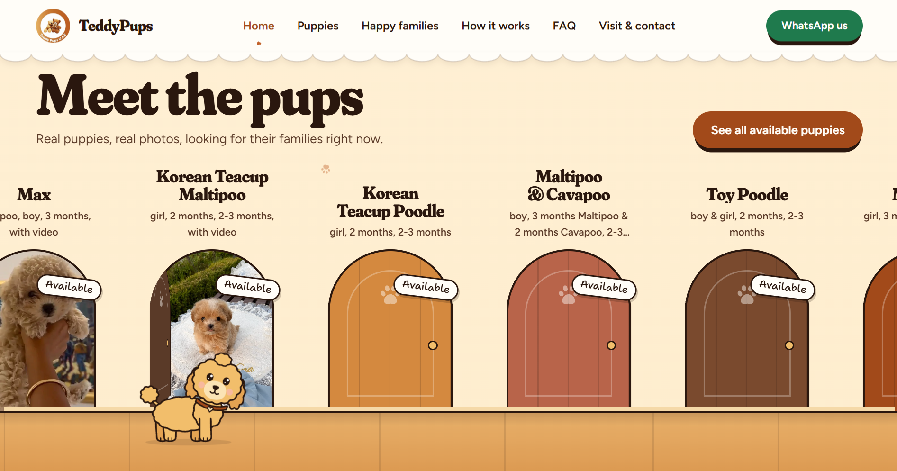
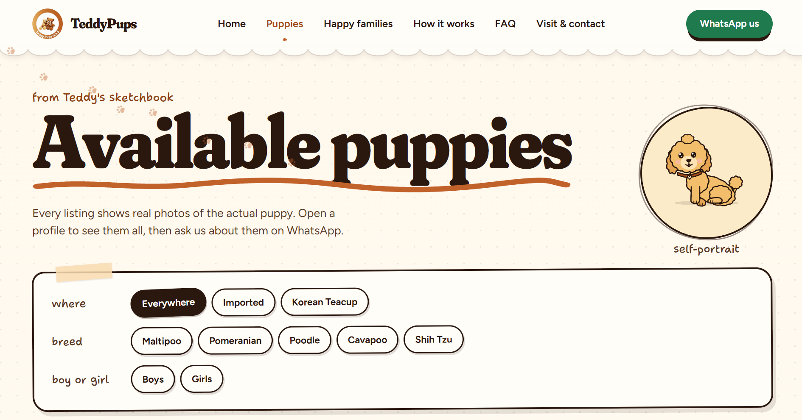

# 🐾 TeddyPups U.A.E. — Luxury Pet Boutique & Concierge Platform

[](https://reactjs.org/)
[](https://vitejs.dev/)
[](https://reactrouter.com/)
[](https://www.w3.org/Style/CSS/)
[](https://developer.mozilla.org/en-US/docs/Web/JavaScript)
[](https://developer.mozilla.org/en-US/docs/Learn/CSS/CSS_layout/Responsive_Design)

> A modern, pixel-perfect frontend replica of the **TeddyPups U.A.E.** luxury pet boutique platform ([puppy.instabizweb.com](https://puppy.instabizweb.com/)). Built from scratch as a modular, production-ready React application featuring an interactive procedural SVG physics mascot rig, smooth scroll-driven Bézier animations, custom plush design system, and full client-side routing.

---

## 📸 Visual Showcase

<div align="center">

### 1. Landing Experience & Hero Mascot Lineup
*Plush serif typography, scalloped quilted archways, interactive call-to-action buttons, and the curious golden mascot puppy peeking over the horizon.*



<br/><br/>

### 2. "Meet the Pups" Treadmill & Arched Kennel Doors
*Real-time scrolling treadmill with handcrafted wooden arched kennel doors, breed badges, and the interactive procedural mascot walking smoothly across the showroom floor.*



<br/><br/>

### 3. Available Puppies Catalog & Sketchbook Filter Board
*Dynamic filter board allowing instant search by source origin (Showroom vs. Imported), breed, and gender, paired with the circular sketchbook self-portrait medallion.*



</div>

---

## ✨ Engineering & Architecture Highlights

### 🐶 1. Procedural SVG Mascot Rig & Physics Engine
Rather than relying on static GIFs or bulky video files, the mascot companion (**Teddy**) is powered by a custom-engineered procedural vector physics engine:
- **Kinematic Skeletal Rig (`pupRig.jsx`)**: Parametric vector generator computing live SVG transformations for body rotation, breathing bounce, ear spring velocity, eye gaze tracking, blinking intervals, tail wagging amplitude, and leg swing strides.
- **Dynamic Pose Interpolation**: Smoothly morphs between distinct anatomical poses (`stand`, `walk`, `sit`, `peek`, `snug`, `bow`, `hop`, `beg`) using exponential damping (`damp(dt, tau)`) with instant un-peek transitions for natural, fluid motion.
- **Scroll-Driven Bézier Pathing (`PupJourney.jsx`)**: Evaluates cubic Bézier spline trajectories across page coordinates on desktop, automatically switching to a persistent bottom lane with calibrated travel windows and organic stepping cadences on mobile screens.
- **Interactive Companion (`PupBuddy.jsx`)**: Reacts to cursor movement, clicks, and idle moments with joyful micro-interactions (`zoomies`, `peekaboo`, `sneeze`, `tilt`, `hearts`, and speech bubbles).

### 🎨 2. Bespoke Plush Design System
- **Curated Typography**: Integrated Google Fonts pairing **Fraunces** (soft plush serif with custom variable font axes `"SOFT" 100`, `"WONK" 1`), **Shantell Sans** (bouncy handwritten script), and **Figtree** (clean modern sans).
- **Physical Paper & Quilted Accents**: Scalloped quilt archways, dashed stitch borders, washi tape tabs, postal ink cancellation stamps, and authentic polaroid cards with subtle randomized tilts.
- **Custom Interactive Cursor**: Signature golden paw cursor (`/cursor/paw.svg`) with rotation dynamics that depresses into a pad-press state (`/cursor/paw-press.svg`) on pointer interactions.
- **Signature Page Transition (`IntroCurtain.jsx`)**: The "every puppy is family" welcome curtain with animated running golden puppy SVG and scalloped hem reveal.

### 🧭 3. Comprehensive Multi-Page Routing
Fully articulated client-side single-page architecture built with **React Router v6**:
| Route | Description |
| :--- | :--- |
| **`/`** | Complete flagship landing page with 8 rich interactive sections (Hero lineup, puppy doors treadmill, 2-way adoption flow, WhatsApp journey dialogue simulator, passport trust book, memory wall, and welcome-home CTA). |
| **`/puppies`** | Live catalog of available puppies with instant breed pills, origin filter, gender selector, video toggle, and modal previews. |
| **`/gone-home`** | Showcase of happily adopted puppies with custom celebratory ticket badges. |
| **`/happy-families`** | Polaroid memory wall featuring 64+ authentic family snapshots with click-to-zoom modal lightbox. |
| **`/how-it-works`** | Step-by-step concierge roadmap featuring an interactive switcher between Local Dubai Showroom and International Import routes. |
| **`/faq`** | Expandable accordion notebook with real-time keyword search. |
| **`/contact`** | Downtown Dubai showroom visiting guide, interactive handwritten letter request form, and custom stylized map card. |
| **`/puppies/:slug`** | Dedicated storybook puppy detail profile with multi-photo carousel, high-definition video player, traits checklist, and direct WhatsApp adoption button. |

---

## 📂 Project Directory Structure

```text
TeddyPups_Clone/
├── public/                     # Static production assets
│   ├── brand/                  # Vector logos & brand identity marks
│   ├── cursor/                 # Custom SVG paw cursors
│   ├── img/                    # High-resolution platform showcase screenshots
│   │   ├── img1.png            # Hero section & mascot lineup
│   │   ├── img2.png            # Arched puppy doors treadmill
│   │   └── img3.png            # Filterable catalog & sketchbook board
│   ├── media/                  # High-resolution puppy photos, videos & illustrations
│   └── favicon & icons
├── src/
│   ├── components/             # Reusable, modular UI components
│   │   ├── pup/                # Mascot physics rig & scroll runner
│   │   │   ├── PupBuddy.jsx    # Standalone interactive mascot companion
│   │   │   ├── PupJourney.jsx  # Scroll-reactive pathing & mobile lane runner
│   │   │   ├── PupStop.jsx     # Journey waypoint marker
│   │   │   └── pupRig.jsx      # Procedural SVG skeletal rig & kinematics
│   │   ├── FlightAnimation.jsx # International concierge airplane flight path
│   │   ├── Footer.jsx          # Illustrated footer with newsletter & navigation
│   │   ├── Header.jsx          # Smart responsive navbar with hide-on-scroll & scallop hem
│   │   ├── HeroLineup.jsx      # Homepage puppy lineup with animated badges
│   │   ├── IntroCurtain.jsx    # "every puppy is family" welcome curtain animation
│   │   ├── JourneyChatSection.jsx # WhatsApp dialogue simulation
│   │   ├── MeetPupsSection.jsx # Arched kennel doors treadmill preview
│   │   ├── PawTrailCanvas.jsx  # Canvas-based interactive cursor paw print trail
│   │   ├── PhotoLightbox.jsx   # Click-to-zoom memory wall lightbox modal
│   │   ├── PuppyCard.jsx       # Card component with status stamps & badges
│   │   ├── PuppyModal.jsx      # Detailed puppy profile modal with video player
│   │   └── ScrollToTop.jsx     # Route transition scroll restoration utility
│   ├── data/                   # Centralized data catalogs & models
│   │   ├── puppies.js          # Available & adopted puppy database
│   │   ├── reviews.js          # Authentic happy family reviews
│   │   └── faq.js              # Comprehensive FAQ items
│   ├── pages/                  # Top-level route views
│   │   ├── HomePage.jsx
│   │   ├── PuppiesPage.jsx
│   │   ├── GoneHomePage.jsx
│   │   ├── HappyFamiliesPage.jsx
│   │   ├── HowItWorksPage.jsx
│   │   ├── FAQPage.jsx
│   │   ├── ContactPage.jsx
│   │   └── PuppyDetailPage.jsx
│   ├── styles/
│   │   └── theme.css           # Fluid typography, design tokens & keyframes
│   ├── App.jsx                 # Client router configuration & global layout
│   └── main.jsx                # Application root mount point
├── index.html                  # HTML5 entrypoint with preloaded font definitions
├── package.json                # Project dependencies and build scripts
├── vite.config.js              # Vite bundler configuration
└── README.md                   # Project documentation
```

---

## 🛠️ Tech Stack & Key Libraries

- **UI Framework**: [React 18.3](https://react.dev/) — Functional components, custom hooks, and concurrent features.
- **Build Tooling**: [Vite 6.0](https://vitejs.dev/) — Lightning-fast ES module HMR and Rollup-optimized production bundling.
- **Routing**: [React Router DOM v6](https://reactrouter.com/) — Declarative client-side routing with parameter matching.
- **Styling Architecture**: Vanilla CSS3 + Modern Design Tokens (`--color-toffee`, `--color-honey`, `--color-cocoa`, `--color-milk`) with zero framework lock-in or runtime CSS-in-JS overhead.
- **Animations**: CSS Keyframes + `requestAnimationFrame` procedural physics loops + Web Animations API.

---

## 🚀 Getting Started Locally

### Prerequisites
- **Node.js**: v18.0.0 or higher
- **npm**: v9.0.0 or higher (or pnpm / yarn)

### 1. Clone the Repository
```bash
git clone https://github.com/rosnnn/TeddyPups_Clone.git
cd TeddyPups_Clone
```

### 2. Install Dependencies
```bash
npm install
```

### 3. Launch Development Server
```bash
npm run dev
```
Open [http://localhost:5173](http://localhost:5173) in your browser to view the application with Hot Module Replacement.

### 4. Build for Production
```bash
npm run build
```
Generates an optimized, minified production bundle in the `dist/` directory.

### 5. Preview Production Build
```bash
npm run preview
```

---

## 📱 Mobile Responsiveness & Polish

- **Adaptive Breakpoints**: Custom media queries engineered for compact smartphones (360px+), modern flagships (390px, 412px, 430px), tablets (768px, 1024px), and ultra-wide displays (1440px+).
- **Zero Horizontal Overflow**: All containers enforce strict overflow containment (`overflow-x: clip`) while maintaining fluid flexbox/grid hierarchies.
- **Persistent Bottom Mobile Lane**: When viewed on small screens or coarse pointers, the mascot gracefully shifts into a non-intrusive floating bottom lane that strolls across the viewport with active leg strides between story sections.

---

## 📄 License

This project is licensed under the [MIT License](LICENSE) — feel free to explore, learn, and build upon this architecture.
